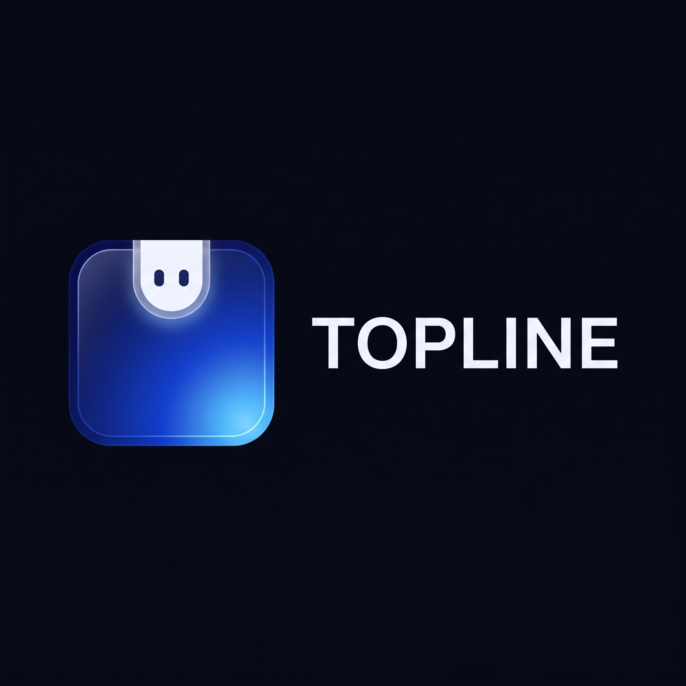
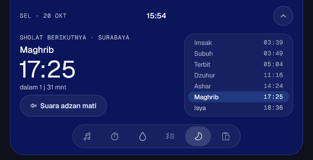
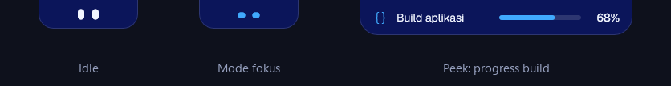
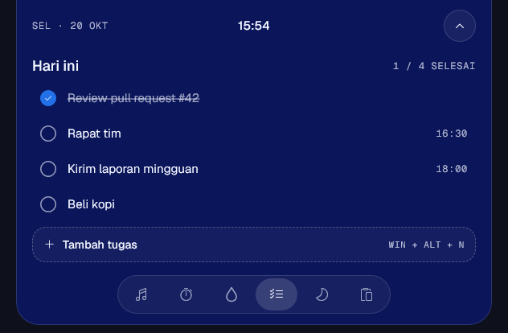
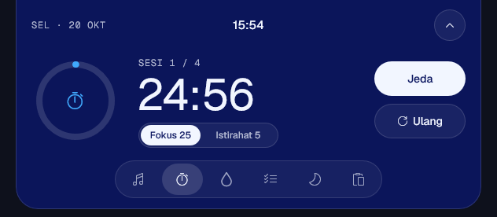
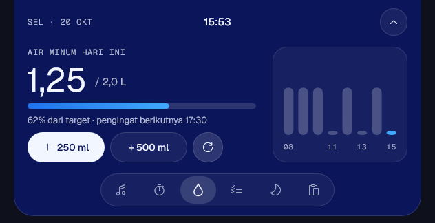
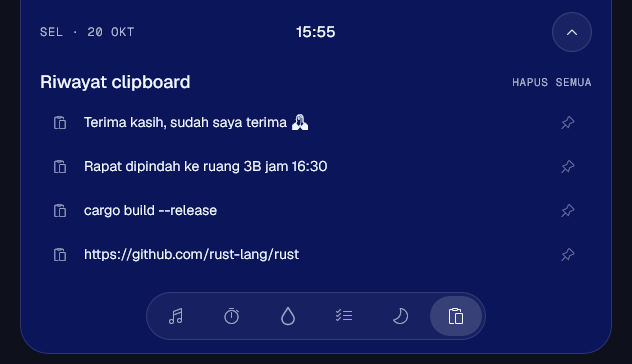

<p align="center">
  
</p>

<h1 align="center">Topline</h1>

<p align="center">
  <b>Notch "hidup" untuk Windows 11.</b><br>
  Musik, fokus, to-do, jadwal sholat, dan kabar sistem di tengah atas layar.<br>
  Rust native · full offline · <b>0% CPU</b> saat idle.
</p>

<p align="center">
  
  
  
  
  
  
</p>

---

Topline mengubah bagian tengah atas layar menjadi pulau kecil yang tahu apa yang sedang
terjadi: lagu yang diputar, sisa waktu Pomodoro, waktu sholat berikutnya, sampai build
yang baru selesai. Arahkan kursor ke atas dan notch akan membuka. Selebihnya ia diam,
tanpa mengganggu.

<p align="center">
  
</p>

<p align="center">
  
</p>

## 📸 Screenshot

<table>
  <tr>
    <td align="center"><br><sub><b>To-do</b>: jam dikenali otomatis</sub></td>
    <td align="center"><br><sub><b>Fokus</b>: timer Pomodoro</sub></td>
  </tr>
  <tr>
    <td align="center"><br><sub><b>Air minum</b>: target harian & grafik per jam</sub></td>
    <td align="center"><br><sub><b>Riwayat clipboard</b>: salin ulang & pin</sub></td>
  </tr>
</table>

## ✨ Fitur

| | Fitur | Keterangan |
|---|---|---|
| 🎵 | **Musik** | Judul, cover, play/pause/next dari Spotify, browser, atau pemutar apa pun (GSMTC) |
| ⏱️ | **Fokus** | Timer Pomodoro dengan cincin progres |
| 💧 | **Air minum** | Target harian dan pengingat |
| ✅ | **To-do** | `Rapat tim 16:30` → jam dikenali otomatis. Tambah dari mana saja dengan **Win + Alt + N** |
| 🕌 | **Jadwal sholat** | Dihitung offline dengan metode Kemenag (44 kota) atau **lokasi saat ini**, plus adzan |
| 🚀 | **Launcher** | Seret aplikasi (termasuk dari Start), file, atau folder ke notch untuk menyematkannya (maks. 8). Hanya referensi; file asli tidak disentuh |
| 📋 | **Riwayat clipboard** | 20 teks terakhir, bisa di-pin. Hanya di memori; isi pengelola sandi diabaikan |
| 🟢 | **Indikator privasi** | Titik hijau saat kamera aktif, oranye saat mikrofon aktif |
| ⬇️ | **Progress & unduhan** | `topline progress 60 "Build"` dari skrip mana pun; unduhan selesai muncul sebagai kabar |
| 🔔 | **Peek sistem** | Volume, baterai, Wi-Fi, Caps Lock; otomatis sembunyi saat aplikasi full-screen |
| 👀 | **Personality** | Sepasang mata yang berkedip, melirik kursor, berayun mengikuti musik, dan tertidur saat Anda pergi |

### Mata yang hidup

Mode Personality memberi Topline tujuh ekspresi:

| Normal | Senang `^ ^` | Menyapa | Fokus | Musik | Baterai lemah | Tidur `z z` |
|---|---|---|---|---|---|---|
| berkedip | tugas selesai | Anda kembali | menyipit | berayun | sayu | 5 menit tanpa input |

Semua animasinya dijalankan oleh compositor Windows (DWM), bukan oleh proses Topline.
Mata yang terus berkedip **tetap memakai 0 CPU**. Jika *Animation effects* Windows
dimatikan, mata ikut diam.

## 🚀 Memasang

1. Unduh `setup.exe` dari halaman **Releases**.
2. Jalankan. Topline terpasang per pengguna di `%LOCALAPPDATA%\Programs\Topline`, **tanpa hak admin**.
3. Mencopotnya bisa lewat **Settings → Apps → Installed apps**.

> Diuji di Windows 11 25H2. Efek kaca (blur) memakai backdrop Windows 11.

## 🕹️ Memakai

| Aksi | Cara |
|---|---|
| Buka/tutup notch | Arahkan kursor ke tengah atas layar, klik notch, atau **Win + Alt + T** |
| Ganti widget | Tab di bagian bawah notch, atau scroll di atas bar tab |
| Volume | Scroll naik/turun di notch (2% per takik; juga di widget Musik) |
| Lagu berikutnya/sebelumnya | Scroll ke samping di notch (touchpad, atau **Shift + scroll**) |
| Play/pause | Klik tengah notch (tanpa musik: mute/unmute) |
| Tambah tugas | **Tambah tugas**, atau **Win + Alt + N** dari mana saja |
| Hapus tugas / tutup peek | Klik kanan |
| Sematkan ke launcher | Seret aplikasi/file/folder dari Explorer, Desktop, atau Start ke notch, lalu lepaskan |
| Atur launcher | Klik tile untuk membuka; seret tile untuk mengubah urutan; klik kanan untuk lokasi file, jalankan sebagai admin, atau lepas sematan |
| Pengaturan | Klik kanan ikon Topline di system tray (gestur scroll bisa dimatikan di sana) |

**Jadwal sholat.** Tray → *Jadwal sholat*, lalu pilih kota atau **Lokasi saat ini**.
Lokasi dibaca sekali dari layanan lokasi Windows lalu disimpan, tanpa pelacakan terus-menerus.
Untuk adzan sendiri, taruh `adzan.wav` di `%LOCALAPPDATA%\Topline`.

**Progress dari skrip atau build:**

```powershell
topline progress start "Build aplikasi"
topline progress 60    "Build aplikasi"
topline progress done  "Build aplikasi"   # atau: fail
```

## 🔒 Privasi

- **Tidak ada jaringan.** Topline tidak pernah mengirim data ke internet.
- Data (tugas, air minum, pengaturan) disimpan di `%LOCALAPPDATA%\Topline\data.json`.
- Riwayat clipboard hanya ada di memori, hilang saat Topline ditutup.
- Lokasi hanya diminta saat Anda memilih *Lokasi saat ini*.

## ⚡ Kenapa ringan

| | |
|---|---|
| CPU idle | **0,000 s / 10 s** (diukur, semua pengamat aktif) |
| `topline.exe` | ~820 KB, tanpa runtime atau WebView |
| Installer | ~1,3 MB |

Rahasianya ada tiga:

- **Tanpa polling.** Semua info datang dari event Windows: GSMTC, `RegisterPowerSettingNotification`,
  `IAudioEndpointVolumeCallback`, Raw Input, `RegNotifyChangeKeyValue`, `ReadDirectoryChangesW`,
  `AddClipboardFormatListener`. Ditambah satu timer deadline untuk kejadian berikutnya.
- **Animasi oleh DWM.** Buka/tutup, equalizer, dan mata adalah animasi Windows.UI.Composition.
- **Gambar ulang hanya saat data berubah**, lewat Direct2D/DirectWrite.

## 🛠️ Build dari source

Butuh Windows 10/11 x64 dan internet untuk build pertama. **Tidak perlu Visual Studio.**

```powershell
git clone https://github.com/MukhamadRoni/topline
cd topline
powershell -ExecutionPolicy Bypass -File build.ps1              # dist\topline.exe + dist\setup.exe
powershell -ExecutionPolicy Bypass -File build.ps1 -SkipSetup   # aplikasi saja
```

`build.ps1` akan:

1. memasang toolchain Rust `stable-x86_64-pc-windows-gnu` ke `.toolchain\` di dalam folder project, tanpa mengubah sistem;
2. mengunduh font [Geist](https://vercel.com/font) (SIL OFL) ke `assets\fonts\`;
3. membuat resource ikon/manifest dengan `windres` jika MinGW-w64 tersedia;
4. menghasilkan `dist\topline.exe` dan `dist\setup.exe`.

Unit test logika inti berjalan di OS apa pun:

```powershell
cargo test -p topline-core -p topline-store
```

## 🧭 Struktur

```
crates/topline-core    semua logika produk (state, Pomodoro, to-do, peek, mata, jadwal sholat) + unit test
crates/topline-store   penyimpanan JSON dengan tulis atomik
apps/topline           aplikasi Windows: Win32 + Windows.UI.Composition + Direct2D/DirectWrite
apps/topline-setup     installer per-user
docs/                  ARCHITECTURE.md · DESIGN.md · ROADMAP.md
```

Logika ada di `topline-core` tanpa dependensi Windows: event masuk sebagai `Command` atau
`SystemEvent`, lalu keluar sebagai `Effects`. Lapisan Windows hanya menggambar dan
menyambungkan event. Detailnya ada di [docs/ARCHITECTURE.md](docs/ARCHITECTURE.md).

## 🗺️ Roadmap

- [ ] Lirik tersinkron (offline)
- [x] Launcher mini dengan drag & drop
- [x] Gestur scroll di notch
- [ ] Shelf file (drag & drop sementara, seret keluar)
- [ ] Jendela Pengaturan lengkap
- [ ] Rapat dari Google Calendar
- [ ] Notifikasi WhatsApp / Telegram
- [ ] Chat AI assistant (pakai API key sendiri)

Daftar lengkapnya ada di [docs/ROADMAP.md](docs/ROADMAP.md).

## 🤝 Kontribusi

Issue dan pull request sangat diterima. Sebelum mulai, baca [AGENTS.md](AGENTS.md) untuk
alur data, konvensi, dan jebakan windows-rs. Aturan utamanya:

- jangan menambah polling atau timer berkala;
- animasi harus lewat Composition;
- logika baru masuk `topline-core` beserta test-nya;
- teks UI berbahasa Indonesia.

Setelah mengubah kode, pastikan build bersih tanpa warning dan CPU idle tetap ~0.

## 📄 Lisensi

[MIT](LICENSE). Font Geist dilisensikan dengan SIL Open Font License 1.1.

<p align="center"><sub>Dibuat dengan Rust dan secangkir kopi ☕</sub></p>
